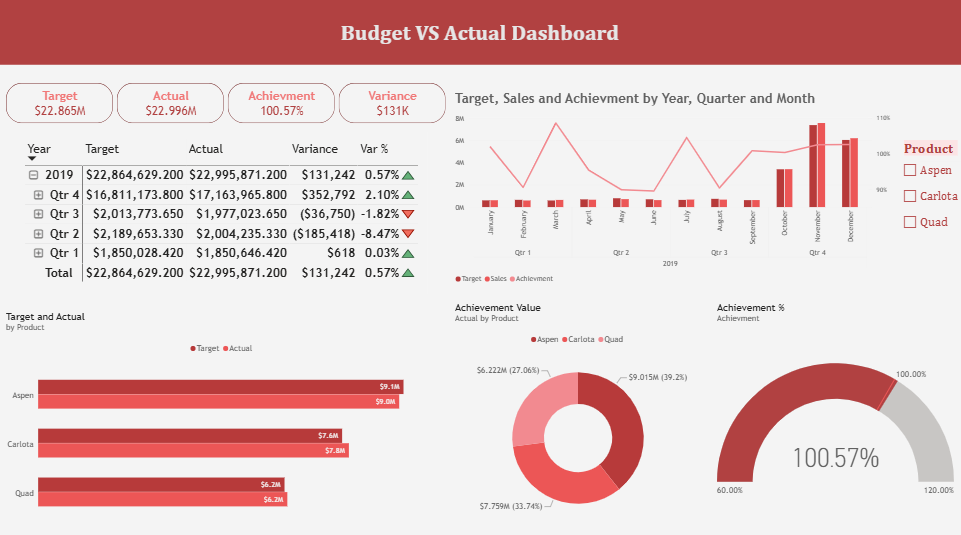
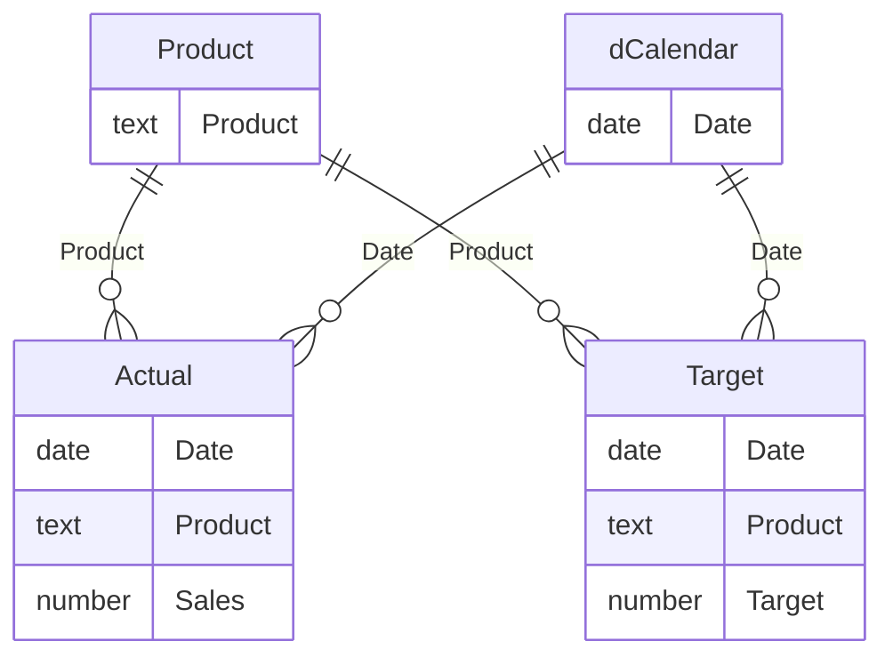

# Budget vs Actual Sales Dashboard (Power BI)

An interactive Power BI dashboard that compares **actual sales against monthly targets** for three products across 2019. It shows how much each product sold, what share of total sales it represents, which products hit their target, and how total actual sales compare with total target.




---

## Business Questions

1. How much did each product sell?
2. What percentage of total sales does each product contribute?
3. Which products achieved their target?
4. What are the total sales (actual) versus the total target?

## Key Findings (2019)

| Product | Actual | Target | Variance | Achievement | Share of Sales | Target hit? |
|---|---:|---:|---:|---:|---:|:---:|
| Aspen   | 9,015,112 | 9,122,585 | −107,473 | 98.8%  | 39.2% | ❌ |
| Carlota | 7,758,920 | 7,590,155 | +168,765 | 102.2% | 33.7% | ✅ |
| Quad    | 6,221,839 | 6,151,889 | +69,950  | 101.1% | 27.1% | ✅ |
| **Total** | **22,995,871** | **22,864,629** | **+131,242** | **100.6%** | 100% | ✅ |

- **Overall the year closed slightly above target** (100.6%, +131K).
- **Two of three products hit their target** (Carlota and Quad). Aspen is the largest product by sales (39%) but narrowly missed its target by 1.2%.
- **Sales are heavily concentrated in Q4**: October–December make up ~75% of annual sales, and the targets follow the same pattern.
- Actual sales fell below target in five months (Feb, Apr, May, Jun, Aug); the strong Q4 brought the year back above target.

## Data

| Source | Content | Grain |
|---|---|---|
| Monthly sales Excel files (one file per month) | `Date`, `Product`, `Sales` | Daily sales per product |
| Targets Excel file | `EOMonth`, `Product`, `Budget` | Monthly target per product |

- Period: **1 Jan 2019 – 31 Dec 2019**
- Actual: 28,773 rows · Target: 36 rows (3 products × 12 months)
- The data was found online (publicly available); the exact original source is unknown. CSV copies of the two tables are in the [`data/`](data) folder.

## Data Preparation (Power Query)

- **Actual** – Loaded all monthly sales workbooks from a folder, expanded the sheets, and **appended them into a single table** (`Date`, `Product`, `Sales`) with correct data types.
- **Target** – Loaded the targets workbook from its own folder; renamed `EOMonth → Date` and `Budget → Target`.
- **Product** – Built a **dimension table** from the distinct product names in the Target table (`Remove Other Columns` → `Remove Duplicates`).
- **dCalendar** – Date table generated with `CALENDARAUTO()` and related to both fact tables for the Year / Quarter / Month hierarchy.

## Data Model

Sales and Target had **no common key** to relate them directly. To solve this, a separate **Product dimension table** was created and both fact tables were connected to it (one-to-many, single direction). In addition, a **date dimension (`dCalendar`)** is connected to the `Date` column of both fact tables, so the time-based visuals (Year → Quarter → Month) filter Actual and Target consistently. The Product slicer and the date hierarchy therefore drive every visual and measure in the report.



## KPIs & DAX Measures

All measures live in the `Product` table.

| KPI | DAX | Meaning |
|---|---|---|
| **Actual** | `SUM(Actual[Sales])` | Total actual sales |
| **Target** | `SUM(Target[Target])` | Total target |
| **Variance** | `[Actual] - [Target]` | Gap vs target (value) |
| **Var %** | `DIVIDE([Variance], [Target])` | Gap vs target (%) |
| **Achievement** | `DIVIDE([Actual], [Target])` | Actual as % of target |
| **Min. Rev.** | `1000000` | Lower bound used for the gauge |
| **Max. Rev.** | `30000000` | Upper bound used for the gauge |

## Dashboard Pages

**Page 1 – Overview** (`Budget VS Actual Dashboard`)
- KPI cards: Target, Actual, Achievement, Variance
- Combo chart: Target and Actual by Year/Quarter/Month with the Achievement line
- Donut chart: share of sales by product
- Gauge: Achievement %
- Clustered bar: Target vs Actual by product
- Matrix: Target, Actual, Variance, Var % by period
- Product slicer

**Page 2 – Detail**
- Table: Actual, Target, Variance by period and product
- Matrix with Var % and Variance
- Line chart: Target vs Actual over time
- Product slicer

## Tools

Power BI Desktop · Power Query (M) · DAX · Excel

## Repository Structure

```
budget-vs-actual-powerbi/
├── README.md
├── data/
│   ├── actual_sales_2019.csv
│   └── target_2019.csv
├── dashboard/
│   └── Budget_vs_Actual_Dashboard.pbix
├── screenshots/
└── .gitignore
```

## How to Use

1. Download `dashboard/Budget_vs_Actual_Dashboard.pbix` and open it in Power BI Desktop.
2. The queries read the source Excel files from local folders. To refresh the data, go to **Transform data → Data source settings** and point the `Actual` and `Target` folder paths to your own copies.
3. Use the Product slicer to filter all visuals.

## Author

**Dena Mohamad** – Data Analyst
